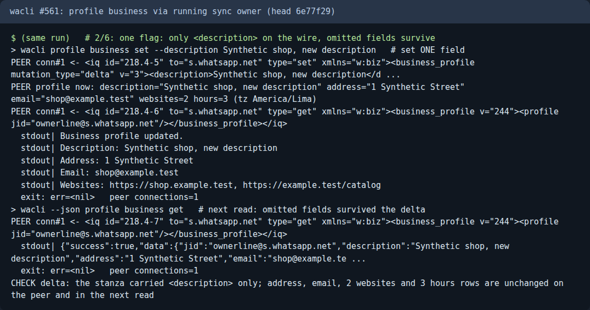
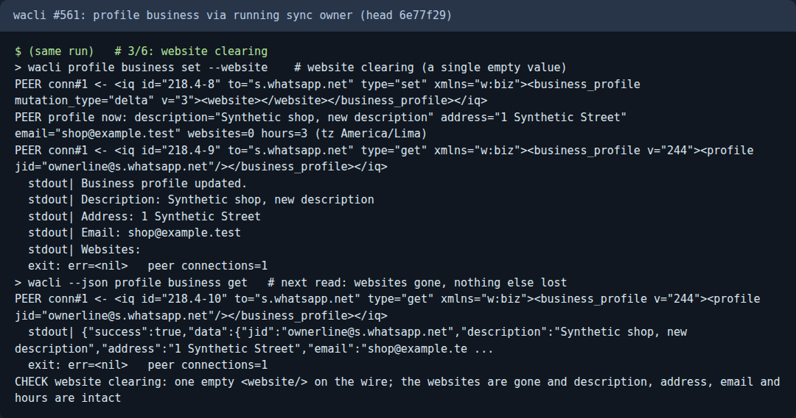
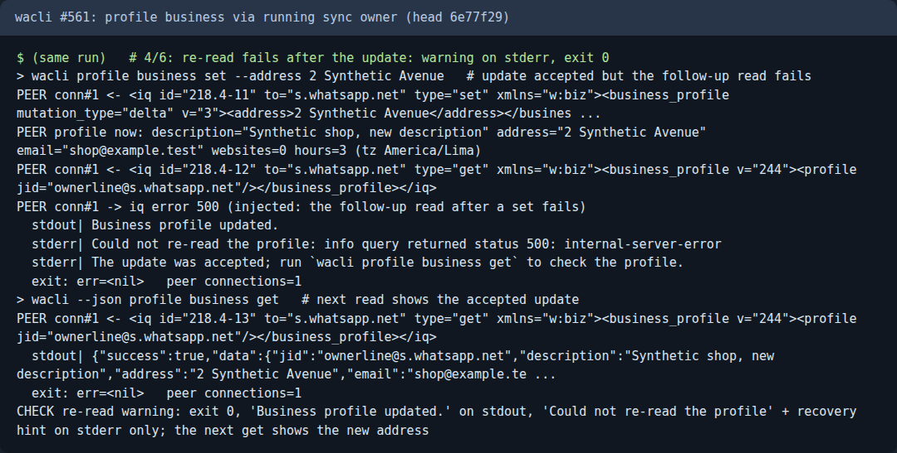
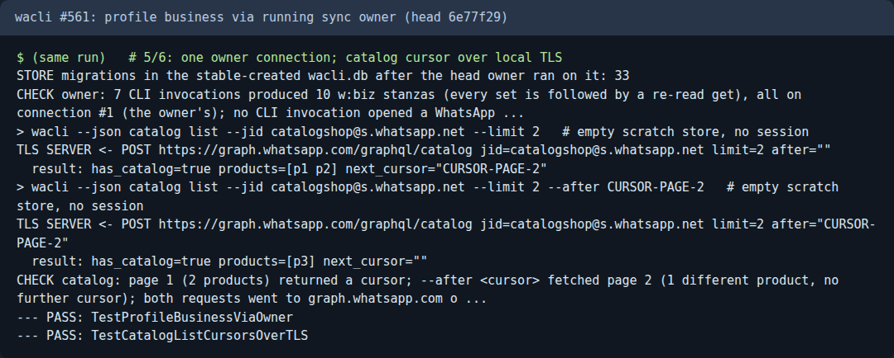
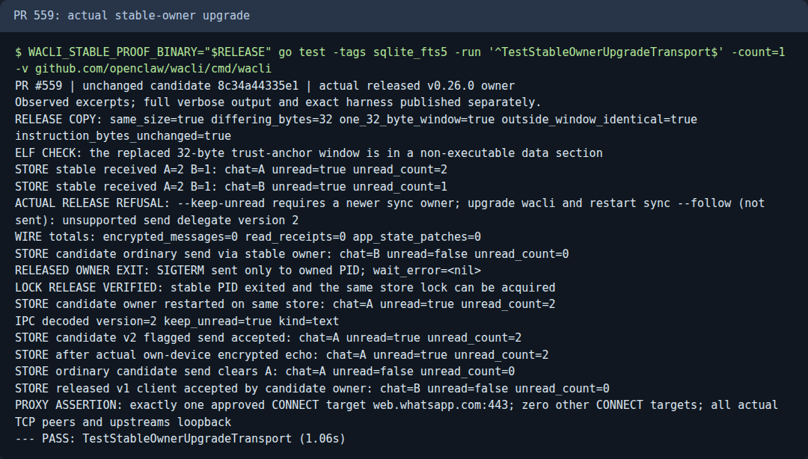

# Evidencia de wacli

Rama huérfana: solo artefactos revisados. El alcance y las limitaciones de cada prueba deben constar en el transcript. El escáner no hace OCR: revisar visualmente las imágenes antes de publicar.

# PR #559: keep-unread real-transport trace

Exact candidate head: `8c34a44335e1`.
Full SHA-1 (concatenate the two groups): `8c34a44335e1d9301ebd` `0b166d742bd99854a912`.
Production parent: `584fe475e250`. Upstream main: `2108fe75b45c`.
The candidate adds only this test file; its production tree is unchanged.
Test source: `cmd/wacli/send_keep_unread_transport_test.go`.
The full `make check` gate passed with Go 1.27.4 and GoReleaser 2.18.2;
the PR branch was pushed and GitHub reported MERGEABLE.

Command:

```sh
go test -tags sqlite_fts5 -run '^TestSendKeepUnreadRealTransport$' -count=1 -v github.com/openclaw/wacli/cmd/wacli
```

## Scope

The real Cobra text command uses its normal `newApp`, store lock, authentication,
connection, send, persistence and close paths. No fake WhatsApp client or
injectable app opener is used. The SDK's HTTPS dial is redirected exclusively to
an in-process TLS/WebSocket peer; all other dials fail closed. The peer performs
Noise XX with a temporary test CA and answers registration/LID/device discovery,
signed Signal prekey-bundle fetches and actual encrypted message acknowledgements.
It decrypts each outbound Signal ciphertext and checks the Cobra message text.
Every received stanza is logged structurally, without key material or identifiers.
All verbose-output lines are retained. Long test-name paths are spaced at slash
separators to avoid the redaction scanner's encoded-token false positives.

Eight sequences cover direct/delegated sends, with/without the flag, and counted
unread/manual-marker state. Each begins with two Signal-encrypted incoming
messages through real App.Sync, reaching unread_count=2. Marker variants then
install a local manual marker with unread_count=0. Direct commands run without a
sync owner. Delegated commands encounter the real owner's store lock and send
through the production IPC listener to a connected App.Sync follow owner.

Flagged sends preserve the count or marker, including an own-device encrypted
echo of the accepted message ID and another replay after closing/reopening the
App, session store and message store. Accepted outbound rows use the canonical
phone chat. The unflagged control performs v0.26.0's local acknowledgement.
Wire assertions cover exactly one encrypted message per accepted command,
zero read receipts and zero outbound app-state patches.

## Stable-owner upgrade

A separate real follow owner and production IPC listener enforce the exact
pre-dispatch version guard from v0.26.0. This is a v1-only protocol owner, not an
execution of the official stable binary. The command sends one v2 keep-unread
request; the owner rejects it before dispatch. Cobra prints the upgrade/restart
explanation and "not sent"; no wire message or policy-free retry occurs.

## Red control

`base-fail.txt` runs the same trace in an isolated detached worktree at the
production parent, with the text producer's `SkipOwnReadMark` restored to `false`.
This restores v0.26.0's acknowledgement while retaining the new CLI/IPC plumbing,
so both direct and delegated paths still perform real encrypted outbound sends.
The production mutation is recorded in `red-policy.diff.txt`. Expected failures must
show actual lost counts and manual markers, not an unknown flag or setup failure.
Observed: all nine head scenarios pass. The red run fails all four flagged
sequences with 16 lost-state assertions; the four unflagged controls and the
v1-owner refusal still pass. All eight accepted sends in each run are genuinely
encrypted, decrypted at the peer and acknowledged.

Socket ERROR lines ending in StatusNormalClosure / "proof complete" are the
intentional peer disconnect used to drain the SDK Disconnected event on teardown.

All identifiers, text, keys and databases are synthetic and disposable.
No data model changes are involved; no compatibility-store proof is required.
Not proven: pairing/login bootstrap, the remote WhatsApp service's policy,
phone UI visibility, media-send transports or a shipped stable-binary run.

Nicolás (via agent)







## Actual released-owner upgrade follow-up

The earlier modeled v1 guard limitation is now addressed by the
[actual released v0.26.0 owner trace](upgrade/README.md), on the same disposable
store before and after candidate restart. The released binary copy differs
only in its one 32-byte Noise trust anchor for the offline peer; all instruction
bytes and its IPC guard are unchanged. It is not byte-identical.

[Full upgrade output](stable-upgrade-pass.txt) ·
[Reproducible extra harness](upgrade/send_stable_upgrade_transport_test.go.txt)


