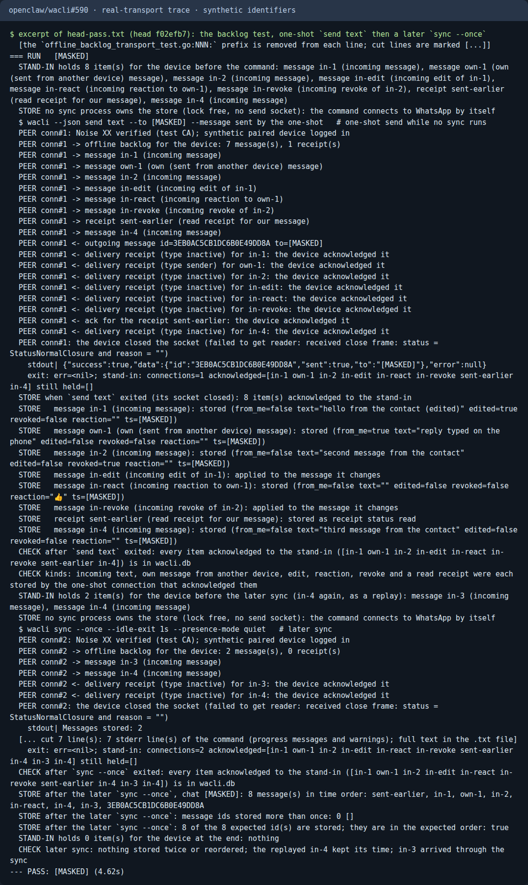
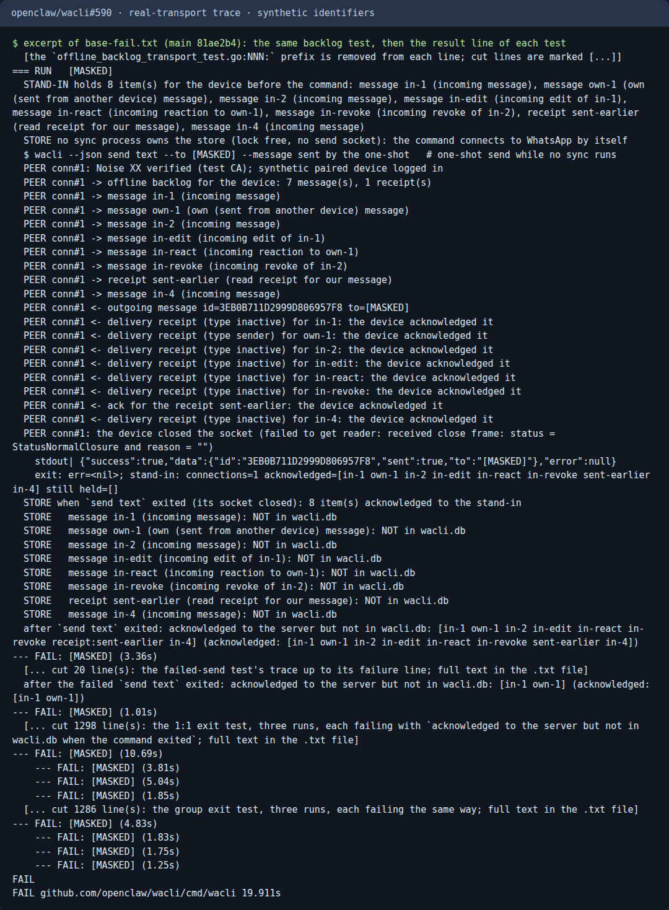
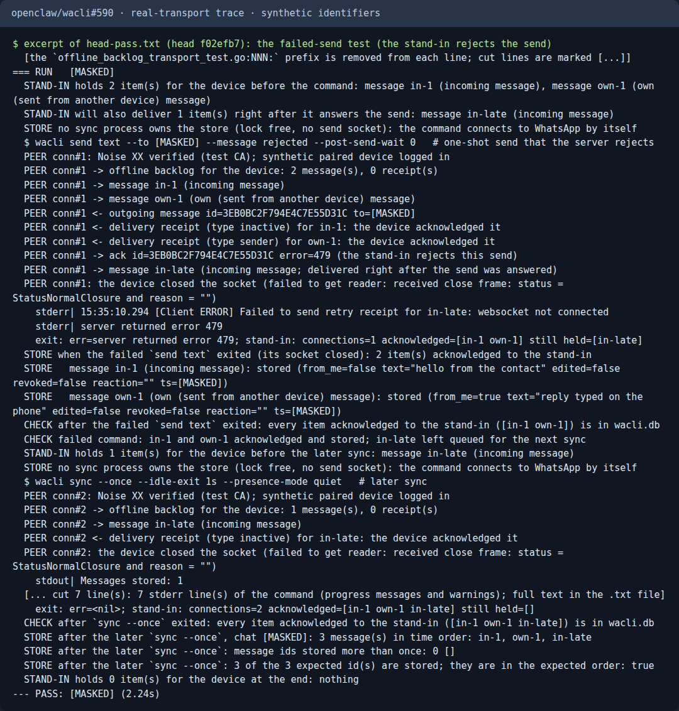
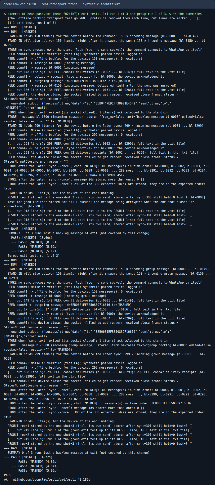

# Evidencia de wacli

Rama huérfana: solo artefactos revisados. El alcance y las limitaciones de cada prueba deben constar en el transcript. El escáner no hace OCR: revisar visualmente las imágenes antes de publicar.

# openclaw/wacli#590: recorded real-transport trace

- Head: `f02efb7579c6` (fork branch `fix/oneshot-offline-backlog`).
- Base: upstream `main` `81ae2b4ff6f1`.
- The kit's redactor rejects 32 or more hex characters, so SHAs are given with 12 characters.
- Run on 2026-11-22, head 20:32-20:35 UTC and base 20:35-20:39 UTC. Each run used a fresh `git archive` copy, go 1.27.4, linux/amd64, with no network.
- Files: `head-pass.txt` (head, all pass), `base-fail.txt` (base, all fail), `exit-series.txt` (result lines of two longer exit series), `shots/terminal-01..04.png`.

Command, run in both copies from the module root. The run gave the four full test names joined by `|`. This pattern selects the same four tests and is written this way because the kit's redactor masks names of 40 or more characters:

```
WACLI_BACKLOG_EXIT_REPS=3 go test -tags sqlite_fts5 -count=1 -v \
  -run '^TestOneShot(SendStoresOfflineBacklog|FailedSendKeepsAcknowledgedBacklog|ExitStoresWhatItAcknowledged|ExitStoresWhatItAcknowledgedFromAGroup)RealTransport$' \
  github.com/openclaw/wacli/cmd/wacli
```

## Method (from the test source, `cmd/wacli/offline_backlog_transport_test.go`)

No `sync` process runs, so the real Cobra commands `send text` and later `sync --once` run in-process and open their own connection. The real whatsmeow client dials WhatsApp's address, and the test routes that address to an in-process stand-in over verified TLS and Noise XX on a WebSocket. The backlog is Signal-encrypted for the device's keys in `session.db` (source lines 58-77). The output shows this in lines such as `STORE no sync process owns the store (lock free, no send socket): the command connects to WhatsApp by itself` and `PEER conn#1: Noise XX verified (test CA); synthetic paired device logged in`.

The stand-in assumes the following about the server (source lines 63-70). It delivers the held items after the device's `active` IQ, between `offline_preview` and `offline`. It drops a message when the device sends its delivery receipt, and a receipt when the device acks it. It delivers anything else again on the next connection. In the backlog and failed-send tests it answers the send only after everything delivered was acknowledged, which WhatsApp does not do. The exit tests answer at once.

## Head (`head-pass.txt`)

1. **Backlog test** (capture 01). `STAND-IN holds 8 item(s)`: incoming text, an own message from another device, an edit, a reaction, a revoke, a read receipt and two more texts. Each line `PEER conn#1 -> message ...` is matched by `PEER conn#1 <- delivery receipt ... the device acknowledged it`, or `<- ack for the receipt sent-earlier` for the receipt. After `send text` exits, every item has a `STORE   ...` line (`stored (...)`, `applied to the message it changes` or `stored as receipt status read`), followed by `CHECK after \`send text\` exited: every item acknowledged to the stand-in (...) is in wacli.db`. The later `sync --once` gets `in-3` and a replay of `in-4`. It ends with `8 of the 8 expected id(s) are stored; they are in the expected order: true`, `message ids stored more than once: 0 []` and `STAND-IN holds 0 item(s)`.
2. **Failed send** (capture 03). The stand-in answers `ack ... error=479`. `in-1` and `own-1` were acknowledged and are `stored` at exit. `in-late`, delivered after the rejection, was not acknowledged and was `left queued for the next sync`. The sync stores it: `3 of the 3 expected id(s) are stored`.
3. **Exit tests, 1:1 and group, 3 runs each** (capture 04). `send text --post-send-wait 0` runs with 150 items held at login and 150 delivered right after the send is answered. In all six runs the one item the command acknowledged (`bl-0000`) is `stored` when it exits, and the test fails otherwise. In five runs the later sync ends with `300 of the 300 expected id(s) are stored`.

## Red control (`base-fail.txt`, capture 02)

The base copy is unmodified `main` plus the test file copied from the head unchanged (same sha256, recorded in the log header). It compiles with no other overlay, and every failure is a test assertion. The backlog test: `8 item(s) acknowledged to the stand-in`, each listed as `NOT in wacli.db`. The failed-send test: `acknowledged to the server but not in wacli.db: [in-1 own-1]`. All six exit runs fail with `acknowledged to the server but not in wacli.db when the command exited`, after acknowledging between 7 and 151 items. No acknowledged item is stored in any base run. The base `SUMMARY 0 of 3 runs lost ...` lines do not count losses: each run stops at that failure before the loss count.

## Remaining window (not closed by this pull request)

In 1:1 exit run 1, `bl-0001` was delivered to the one-shot and not acknowledged by it. It was delivered again to the later sync and acknowledged there, and it is not in `wacli.db`: `RESULT rep=1 ... lost=1 [bl-0001]`. The test labels it `the message being decrypted when the one-shot closed its connection`. Measured here: `SUMMARY 1 of 3 runs lost a backlog message at exit` (1:1) and `SUMMARY 0 of 3` (group). These runs are too few to give a rate.

`exit-series.txt` has the result lines of a longer series at the same head, 20 exits per kind, run the same day: `SUMMARY 6 of 20 runs lost a backlog message at exit` (1:1) and `SUMMARY 9 of 20` (group), one message per losing run, and both tests pass, so nothing the command had acknowledged was missing from `wacli.db` at exit. Its second block is the same series on the follow-up branch `fix/oneshot-exit-fence` (`21051cc0`), which is not part of this pull request: `SUMMARY 0 of 20` for both kinds.

## Not proven

This proof does not cover a live account, WhatsApp's real queue policy (the stand-in's assumptions above), pairing or login, the phone UI, or a separate CLI process (the commands run in-process). It makes no claim about production.

## Redaction

The `.txt` files hold the complete `-v` output, passed through the kit's `mask()`. That masks the four test names, the synthetic phone numbers and JIDs, and the epoch seconds as `[MASKED]`, and normalizes characters (NFKC: `...` becomes `...`). Nothing else is edited. All identifiers are synthetic test values. The captures are excerpts. In them, the `offline_backlog_transport_test.go:NNN:` prefix is removed from each line, no line is reordered or reworded, and every cut is marked `[... cut N line(s): ...]`.







