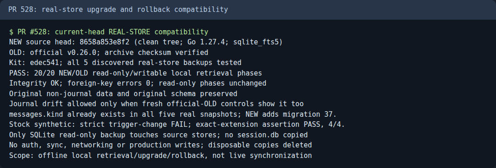

# Evidencia de wacli

Rama huérfana: solo artefactos revisados. El alcance y las limitaciones de cada prueba deben constar en el transcript. El escáner no hace OCR: revisar visualmente las imágenes antes de publicar.

## PR #528: current-head real-store compatibility

NEW is the clean PR head `8658a853e8f2`, built with Go 1.27.4 and `sqlite_fts5`. OLD is the official v0.26.0 Linux amd64 release, verified against its published archive checksum:

sha256=2c28f65e2f9aaf32585288229db1f916c6c5fb5db9513715017d528513604b44

**PASS: all five discovered real stores, all twenty NEW/OLD read-only/writable retrieval phases.** The expected inventory was five; none were skipped. Integrity checks pass, foreign-key errors are zero, read-only phases perform no writes, and original non-journal rows/columns/schema objects/constraints are preserved. messages.kind already exists in all five real snapshots; NEW adds migration 37.

### Differential journal controls

The kit fix at `edec541` opens a separate fresh SQLite backup with the official OLD binary before testing NEW. Only `change_state` and `message_changes` may differ, and only if OLD itself changes the same allowlisted table on its fresh writable control. The reported `tolerated_journal_tables` expose every allowance. No other table, constraint, trigger, index or view change is excused. Earlier real-store attempts using kit `2dc6ca6` stopped on this known writable-open retention behavior; they are superseded by these complete controlled runs, not converted to passes.

### Supplemental stock-store upgrade

The real snapshots already contain `messages.kind`, so they do not test first-time column creation. The supplemental stock v0.26.0 synthetic baseline has no such column. Its strict kit verdict is FAIL solely because migration 37 intentionally extends `retrieval_messages_update`. A separate explicit PR-specific assertion passes all four NEW/OLD read-only/writable phases: removing exactly one `OR old.kind IS NOT new.kind` term from the new trigger tokens must reproduce the original trigger exactly; all other original schema/data invariants remain strict. The raw strict failure and separate result are both preserved, not relabeled as a strict pass.

### Safety and limits

The only source-store access is SQLite read-only/query-only backup of `wacli.db`. No `session.db` was copied. The kit deleted its disposable data and control copies on exit. Every binary command is local chats/messages/FTS retrieval, never auth, doctor or sync. No production writes, deployment, daemon interaction or live WhatsApp operation was performed. This proves the recorded local retrieval/upgrade/rollback invariants on these snapshots, not every possible migration or remote-service behavior. See `results.json` for complete per-store assertions and binary hashes, and `transcript.txt` for the raw redacted kit output.

